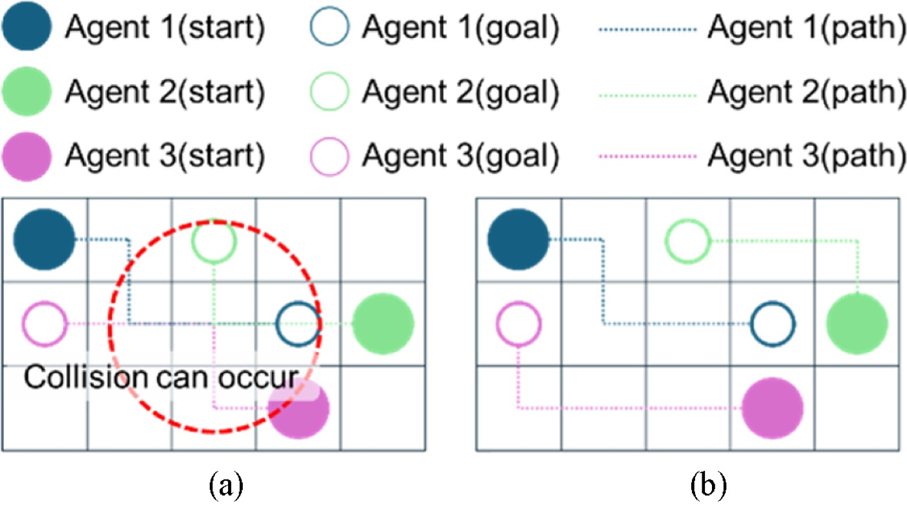
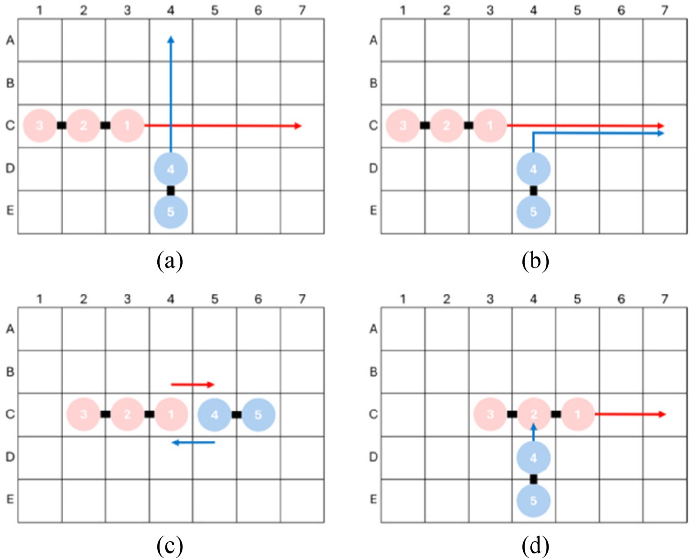
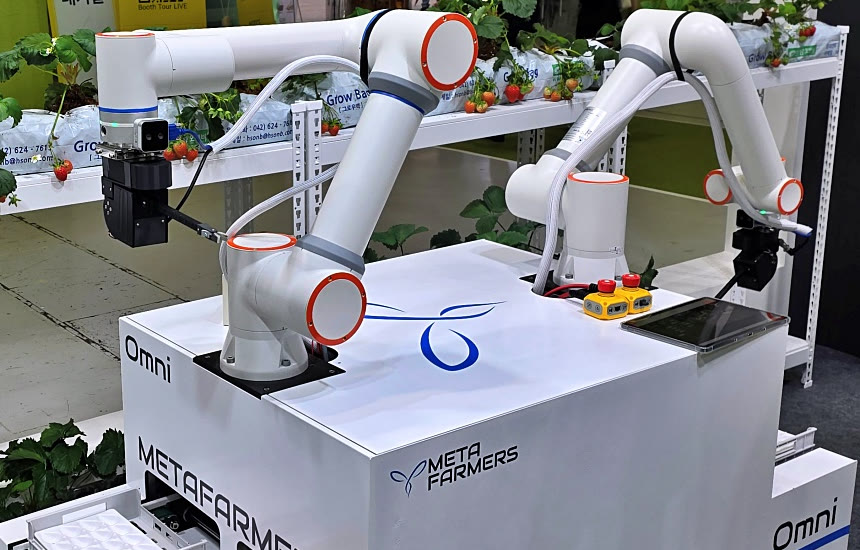
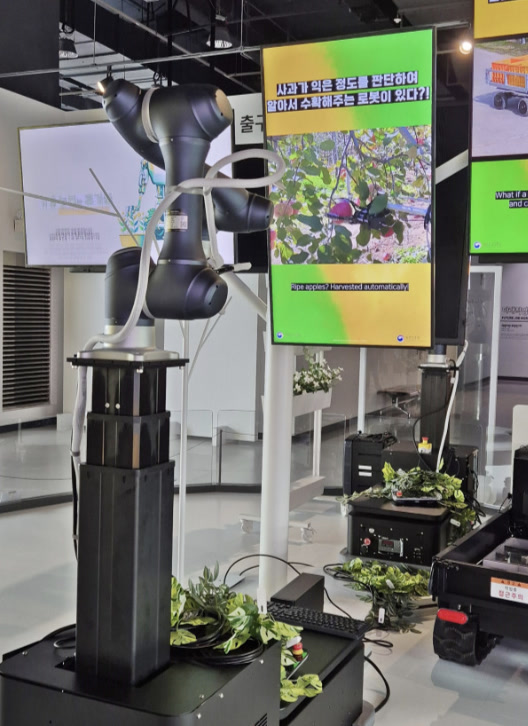
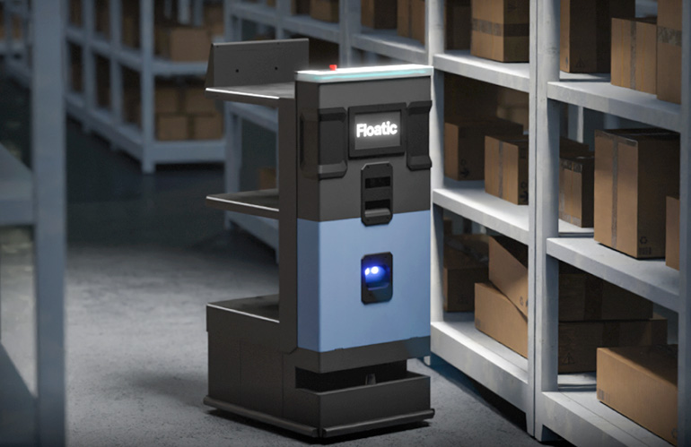
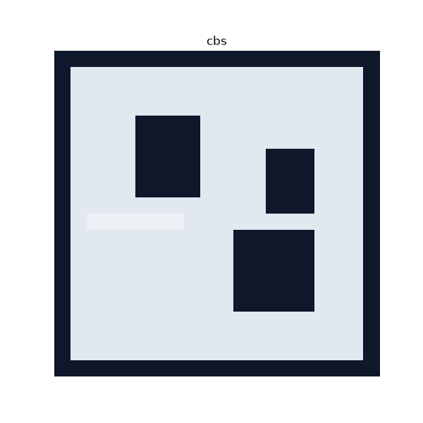

# ChanHui Jung

정찬희 · M.S. student in Robotics, University of Michigan

[Website](https://ladianchad.github.io/ladianchad/) &nbsp;·&nbsp; [CV](https://ladianchad.github.io/ladianchad/cv.pdf) &nbsp;·&nbsp; [Google Scholar](https://scholar.google.com/citations?user=pR_cJxIAAAAJ&hl=en) &nbsp;·&nbsp; [LinkedIn](https://www.linkedin.com/in/ch-ladi) &nbsp;·&nbsp; [chanhui@umich.edu](mailto:chanhui@umich.edu)

I work on multi-robot navigation and multi-agent path finding, with a focus on crowded spaces where robots keep blocking each other. Before Michigan I spent three years in industry. At Floatic I built the navigation stack and middleware for a fleet of warehouse robots. At Metafarmers I led a seven-person robotics team that put two agricultural robots into production.

**I am looking for PhD positions starting in Fall 2027.**

## Experience

<table>
  <tr>
    <td valign="top">Sep&nbsp;2025&nbsp;– Apr&nbsp;2026</td>
    <td>
      <b>Robotics Software Team Lead</b> · <a href="https://metafarmers.ai">Metafarmers</a>, Seoul 
      Built and led a seven-person robotics team. Owned the Omni Farmer robotics stack from architecture to production, and designed the multi-robot management system so the deployment could grow to larger fleets.
    </td>
  </tr>
  <tr>
    <td valign="top">Jul&nbsp;2022&nbsp;– Sep&nbsp;2024</td>
    <td>
      <b>Robotics Software and Platform Engineer</b> · Floatic, Seoul 
      Designed the Flody robot software architecture, with a middleware layer that kept robot code independent of the backend. Built multi-robot navigation for three warehouse sites and ran a fleet of 10 robots for more than 300 hours.
    </td>
  </tr>
</table>

## Education

<table>
  <tr>
    <td>2026&nbsp;–&nbsp;present</td>
    <td><b>M.S. in Robotics</b> · University of Michigan</td>
  </tr>
  <tr>
    <td>2016&nbsp;–&nbsp;2023</td>
    <td><b>B.S. in Robotics Engineering</b> · Hanyang University ERICA</td>
  </tr>
</table>

## Research

<table>
  <tr>
    <td valign="top">2024&nbsp;– 2025</td>
    <td>
      <b>Multi-agent path finding in congested environments</b> · AIRO Lab, Hanyang University ERICA 
      Research collaboration on continuous-time CBS and on merging and splitting agents. Co-authored the two papers below.
    </td>
  </tr>
  <tr>
    <td valign="top">2019&nbsp;– 2021</td>
    <td>
      <b>Undergraduate Researcher</b> · AIRO Lab, Hanyang University ERICA 
      Advised by Prof. Min-Sung Kang. Stereo pose estimation for screw insertion in the Item Assembly AI Robot Challenge.
    </td>
  </tr>
</table>

## Publications

<table>
  <tr>
    <td width="30%" valign="top"></td>
    <td valign="top">
      <b>A Study on Improving Conflict Based Search with Continuous Time Using Space Utilization</b> 
      S. Im, S. Yoo, H. Kang, <b>C. Jung</b>, D. Han, M.-S. Kang 
      <i>Journal of the Korean Society for Precision Engineering</i>, 43(4), 317–324, 2026 
      <a href="https://doi.org/10.7736/JKSPE.025.045">DOI</a> · <a href="http://jkspe.or.kr/upload/pdf/JKSPE-025-045.pdf">PDF</a>
    </td>
  </tr>
  <tr>
    <td valign="top"></td>
    <td valign="top">
      <b>A Study on Improving Multi-agent Path Finding in Congested Environments Using Agent Merging and Splitting</b> 
      S. Yoo, S. Im, H. Kang, <b>C. Jung</b>, D. Han, M.-S. Kang 
      <i>Journal of the Korean Society for Precision Engineering</i>, 43(2), 123–131, 2026 
      <a href="https://doi.org/10.7736/JKSPE.025.044">DOI</a> · <a href="http://jkspe.or.kr/upload/pdf/JKSPE-025-044.pdf">PDF</a>
    </td>
  </tr>
</table>

Figures reproduced from the papers under CC BY-NC 3.0.

## Projects

### Industry

<table>
  <tr>
    <td width="30%" align="center" valign="top"></td>
    <td valign="top">
      <b><a href="https://ladianchad.github.io/ladianchad/projects/omni-farmer.html">Omni Farmer: agricultural robots</a></b> 
      Metafarmers, 2025–2026 
      Strawberry harvesting and pollination robots. Defined the ROS 2 architecture from the motor control boards up to navigation, and kept localization stable across a 100 × 200 m site. Two robots went into production.
    </td>
  </tr>
  <tr>
    <td align="center" valign="top"></td>
    <td valign="top">
      <b><a href="https://ladianchad.github.io/ladianchad/projects/gwacheon-apple-robot.html">Apple-harvesting exhibit robot</a></b> 
      Metafarmers, 2026 
      A robot delivered to the Gwacheon National Science Museum for its farm-technology exhibition. It recognizes apples and picks them without bruising, using a gripper from the Rural Development Administration.
    </td>
  </tr>
  <tr>
    <td align="center" valign="top"></td>
    <td valign="top">
      <b><a href="https://ladianchad.github.io/ladianchad/projects/flody.html">Flody: warehouse robot fleet</a></b> 
      Floatic, 2022–2024 
      Robots shared their poses and planned paths over a site-local Redis bus and added nearby robots to their own costmaps. Fleet deadlocks went from 3–4 per hour to about one every two hours, across 10 robots and 3 warehouse sites. 
      <a href="https://www.youtube.com/watch?v=0acR1xwGQf8">Demo video</a> · <a href="https://www.therobotreport.com/floatic-raises-38m-for-amrs-to-tackle-e-commerce-picking/">The Robot Report</a>
    </td>
  </tr>
</table>

Photos: Sanup Ilbo (Omni Farmer); Floatic, via The Robot Report (Flody).

### Contract, lab and undergraduate work

<table>
  <tr>
    <td width="30%" valign="top"><a href="https://ladianchad.github.io/ladianchad/projects/churo.html">Churo: dog behavior recognition</a> ROBOI contract, 2021</td>
    <td valign="top">Behavior recognition for a dog-care robot. YOLOv5 and SORT followed the dog, and a ResNet-CRNN classifier sorted 20-frame clips into five behaviors at 90.4–96.8% test accuracy.</td>
  </tr>
  <tr>
    <td valign="top"><a href="https://ladianchad.github.io/ladianchad/projects/item-assembly.html">Item Assembly: stereo hole detection</a> AIRO Lab, 2020</td>
    <td valign="top">Pose estimation for screw insertion in a government-funded furniture-assembly challenge. YOLOv5 found screw holes and stereo triangulation gave their 3D pose.</td>
  </tr>
  <tr>
    <td valign="top"><a href="https://ladianchad.github.io/ladianchad/projects/rescue-robot.html">Help: marine rescue-assist robot</a> Capstone, 2020–2022</td>
    <td valign="top">An unmanned robot for marine accidents. It detects capsizing, finds people in the water with RGB and thermal cameras, and reports their GPS position. Special Prize at the 2022 National Capstone Design Competition.</td>
  </tr>
  <tr>
    <td valign="top"><a href="https://ladianchad.github.io/ladianchad/projects/recycling-robot.html">Latte Panda: recycling and donation robot</a> Intelligent Robot Crash Lab, 2020</td>
    <td valign="top">A ROS service robot on a LattePanda and Jetson TX2. It classified cups as paper or plastic and walked visitors through sorting and a QR donation.</td>
  </tr>
  <tr>
    <td valign="top"><a href="https://ladianchad.github.io/ladianchad/projects/unieye.html">Pattern inspection with two industrial cameras</a> UNIEYE, Feb–Jul 2020</td>
    <td valign="top">A C++/Qt inspection program on a Jetson Nano with two Basler cameras that passed or failed each part.</td>
  </tr>
</table>

## Open source

<table>
  <tr>
    <td valign="top">2022</td>
    <td><a href="https://github.com/ros-navigation/navigation2/pull/3068">navigation2 #3068</a> Proposed a plugin-based navigator design, shipped as <code>nav2_core::NavigatorBase</code>.</td>
  </tr>
  <tr>
    <td valign="top">2022</td>
    <td><a href="https://github.com/ros2/rcl/pull/1003">ros2/rcl #1003</a> Fixed <code>rcl_wait</code> returning an error when a timer is cancelled.</td>
  </tr>
  <tr>
    <td valign="top">2022</td>
    <td><a href="https://github.com/ros-navigation/navigation2/pull/3141">navigation2 #3141</a> Fixed path joining in <code>RewrittenYaml</code>.</td>
  </tr>
  <tr>
    <td valign="top">2023</td>
    <td><a href="https://github.com/ros-navigation/navigation2/pull/3927">navigation2 #3927</a> Fixed the MPPI controller test build.</td>
  </tr>
</table>

## Study notes

<table>
  <tr>
    <td width="30%" align="center" valign="top"></td>
    <td valign="top">
      <a href="https://robotics-study.github.io/">robotics-study</a> is a set of open study notes in English and Korean. Each algorithm is implemented in both C++ and Python and replayed step by step in the browser.  
      <a href="https://robotics-study.github.io/mrmp_introduction/">Multi-robot motion planning</a>: Prioritized A*, CBS, PIBT, RHCR, dRRT*, db-CBS 
      <a href="https://robotics-study.github.io/navigation_basic/">Navigation planning</a>: graph search, sampling planners, DWA, MPC, MPPI 
      <a href="https://robotics-study.github.io/modern_robotics/">Modern Robotics</a>: all 13 chapters of Lynch and Park, with live figures 
      <a href="https://robotics-study.github.io/linear_algebra_to_kalman/">Notes for ROB 501</a>: proofs to the Kalman filter  
      I also wrote 45 Korean posts on ROS 2 and Nav2 internals on <a href="https://coding-robot.tistory.com/">my blog</a>.
    </td>
  </tr>
</table>
